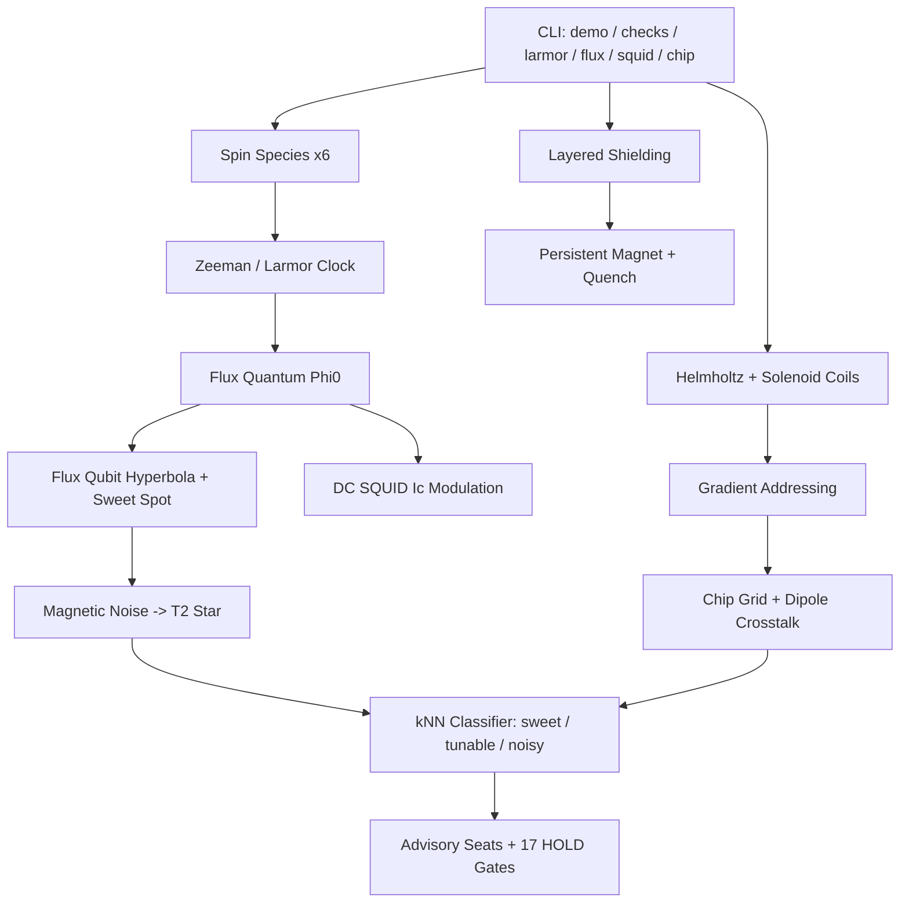
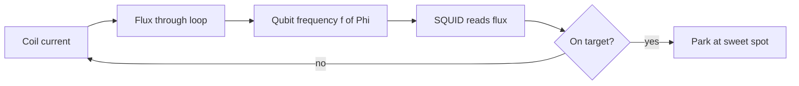
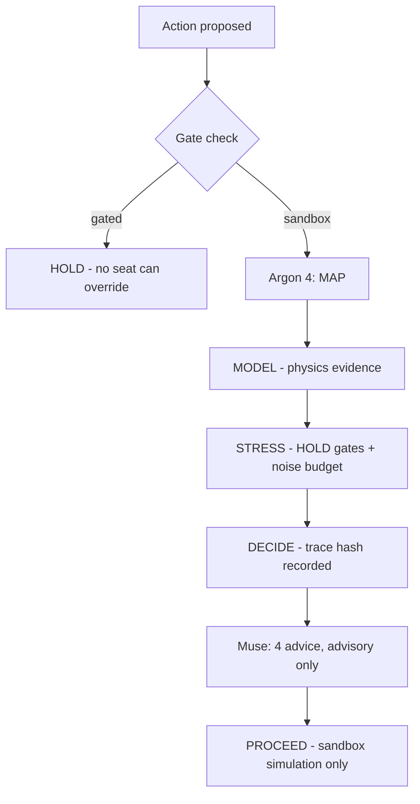

# MagChip-Q 🧲⚛️

**Quantum Chip Magnet Computer Lab** — an educational lab in ONE pure-Python file, by Darion Kellar, about the quantum computer where **the magnet is the machine**: the magnetic field sets every qubit's clock (**Zeeman / Larmor**), magnetic flux through a loop tunes superconducting qubits one **flux quantum (Φ0 = h/2e)** at a time, a **DC SQUID** reads flux at the single-quantum level, **Helmholtz coils and solenoids** make the field, **layered shields** keep the Earth's field out, a **persistent superconducting magnet** holds field for months, **magnetic noise** sets the coherence budget, and **dipole crosstalk (1/r³)** sets how close qubits can sit on the chip. Simulation and learning only — no hardware, no chip designs, no quantum-advantage claims; every real-world operation sits behind a permanent HOLD gate (17 total). 🔒


> ℹ️ The two workflow badges above are the **live** GitHub Actions badges for this repo — they light up as soon as the `ci.yml` and `docker-publish.yml` files from the paste pack are pasted into `.github/workflows/`.

## 🧰 Tech Stack Badges & Full Architecture Tech Stack

### 💻 Core Programming Languages & Core Systems


- 🐍 Python 3.12, pure standard library (`math`, `hashlib`, `json`, `sys`) — ONE file: `main.py`
- ⚛️ Physics core: Larmor `f = γ̄·B` for 6 spin species, Zeeman splitting `ΔE = h·f`, flux quantum `Φ0 = h/2e = 2.067833848×10⁻¹⁵ Wb`, flux-qubit hyperbola `f(Φ) = √(f_min² + ε(Φ)²)` with persistent-current slope ≈ 312 GHz/Φ0, SQUID `Ic(Φ) = Ic_max·|cos(πΦ/Φ0)|`, Helmholtz `(4/5)^1.5·μ0·N·I/R`, solenoid `B = μ0·n·I`, layered shielding, persistent-magnet drift, quench energy `E = ½·L·I²`, magnetic-noise dephasing `T2* = 1/(π·δf)`, dipole crosstalk `∝ 1/r³`
- 🧠 TinyML kNN chip operating-point classifier (from scratch, stdlib) on (sweet-spot distance, flux noise, crosstalk) → `sweet` / `tunable` / `noisy`
- 🧑‍⚖️ Advisory seats inside `main.py`: **Gemini Argon 4 Extended Thinking** (the Gemini Carbon 4 seat — engine `gemini-2.5-pro`, model `google/gemini-carbon-4-extended-pro-thinking`) as DECIDER, MAP → MODEL → STRESS → DECIDE with sha256 trace, tiers 2048 / 8192 / 32768, names-only, tighten-only; **Muse** advisor (muse-spark-1.1 / muse-wonder-1.0, exactly 4 advice, can_override_hold = False); **Google Flow** — all 4 flows plan-only (rendered = False, live = 0)

### ⛓️ Web3 & Infrastructure

Not used — this lab is an offline physics simulation. No blockchain, no Web3 libraries, no network calls of any kind.

### ⚙️ Platform Support & Hardware Architecture


- 🖥️ Runs anywhere Python 3.12 runs — Linux, macOS, Windows, any CPU architecture
- 🚫 Controls **no hardware**: no magnets, coils, cryostats, chips, or instruments (all behind HOLD gates)

### ⚡ Low-Level Infrastructure & Performance


- 🚀 Zero dependencies, zero network, zero install friction for the lab itself
- 🎯 Deterministic end to end: run it twice, get byte-identical output

### 🛠️ DevOps & Build Tools


- 🐳 Docker image (`python:3.12-slim`), target: `credkellar/magchip-q:latest`
- ⚙️ GitHub Actions CI + Docker Publish workflows — delivered in the paste pack for `.github/workflows/`

### ☁️ Cloud Providers

Not used — this lab runs fully offline on your own machine or in a local Docker container. No cloud account, no API keys, no hosted services.

## What this does?

1. 🧭 **Spin species table** — 6 magnetic qubits with published gyromagnetic ratios: electron (28,024.95 MHz/T), proton ¹H (42.577 MHz/T), ¹³C (10.708), ²⁹Si (8.465), ³¹P (17.235), ¹⁴N (3.077).
2. 🕐 **Zeeman / Larmor clock** — `f = γ̄·B`, the splitting in meV and in kelvin (electron @ 1 T = 0.1159 meV = 1.345 K), the field needed for any target frequency (5 GHz electron spin = 0.1784 T), and Larmor precession `P(+x) = cos²(π·f·t)`.
3. 🌀 **The flux quantum** — Φ0 = h/2e; one Φ0 through a 40 µm² loop takes just 51.7 µT, so the Earth's 50 µT field threads 0.967 Φ0 through it. That one number explains the whole shielding industry.
4. 🎚️ **Flux-qubit tuning** — the hyperbola `f(Φ) = √(f_min² + ε(Φ)²)`, f_min = 4 GHz at the sweet spot, slope ≈ 312 GHz/Φ0: at Φ0/2 + 0.001 the qubit is already at 4.012 GHz, at +0.01 it's at 5.073 GHz. Qubits live within a few mΦ0 of the sweet spot.
5. 💓 **DC SQUID** — `Ic(Φ) ∝ |cos(πΦ/Φ0)|`: max at 0, zero at Φ0/2, back to max at Φ0 — a flux meter with a one-Φ0 heartbeat, plus the inverse (flux from a measured Ic ratio) and its field period.
6. 🧲 **Coils** — Helmholtz pair (100 turns, 1 A, 0.1 m → 0.899 mT), solenoid (n = 5000/m, 2 A → 12.566 mT), the inverse current solver, and gradient addressing (electron spins 10 µm apart in a 10 T/m gradient split by 2.8 MHz — individually addressable).
7. 🛡️ **Shielding** — layers multiply: Earth's 50 µT through [100, 100, 10] leaves 0.0005 µT (0.5 nT) at the chip.
8. 🔋 **Persistent magnet + quench** — stored energy `E = ½LI²` (10 H, 100 A → 50,000 J), a model quench temperature rise (+5.0 K into 50 kg of winding), and ppm/hour drift (5 T at 10 ppm/hr hits 99.9% after 100 hours).
9. 📉 **Magnetic noise = coherence** — `T2* = 1/(π·δf)`: at the sweet spot the first-order flux sensitivity is exactly zero; 1 mΦ0 away (Φ = 0.501) with 10 µΦ0 noise, T2* = 1.31 µs; at Φ = 0.51 it collapses to 0.166 µs. Spin qubits: a proton in 1 µT noise holds 7,476 µs, an electron only 11.36 µs — γ̄ cuts both ways.
10. 📐 **Chip layout** — grid designer (4×4 at 100 µm pitch = 16 qubits, 0.16 mm²), dipole crosstalk calibrated to 1 mΦ0 at 50 µm and falling as 1/r³ (0.125 mΦ0 at 100 µm), the pitch solver for a crosstalk budget (0.1 mΦ0 → 107.7 µm), and a frequency-collision finder.
11. 🧠 **Classifier + council + checks** — kNN verdict on any operating point, and a wired council: Argon 4 DECIDER records PROCEED for sandbox simulation and HOLD for any gated real-world action (`python3 main.py council real_magnet_control` → HOLD), Muse advises, Google Flow plans — plus a built-in CHECKS suite (72 checks).

## 🗺️ How it works — diagram per script

### `main.py` — the whole lab



### The tuning loop (conceptual)



## 🧠 Brains — Gemini Argon 4 Extended Thinking + Google Flow (merged)

**🧠 Gemini Argon 4 Extended Thinking** — Darion's name for the Gemini Carbon 4 seat, merged in full as the council DECIDER:

- Engine `gemini-2.5-pro`, model `google/gemini-carbon-4-extended-pro-thinking`
- **MAP → MODEL → STRESS → DECIDE** on every decision, with a sha256 trace hash recorded
- Thinking tiers **2048 / 8192 / 32768** by stakes — 32768 for deploy decisions
- `GEMINI_API_KEY` names/presence-only, live calls 0, tighten-only — it can add a HOLD, it can **never override one**
- Wired into the council verdict: sandbox simulation = **PROCEED**, any gated real-world action = **HOLD** · Commands: `brains`, `carbon`, `council`

**🎬 Google Flow** — all 4 flows, plan-only (`rendered = False`, live = 0):

- **FlowX** — the chip-design cycle as an 8-step task graph (spec the field → classify the operating point), never executed live
- **Workspace Studio** — chip design summary + release-note drafts; nothing is sent (`flow_workspace_send` is a HOLD gate)
- **Filmmaking** — a 5-shot storyboard for a MagChip-Q explainer (coil ramp → flux quanta → sweet spot → shield closing → coherence hold), never rendered (`live_video_generation` is a HOLD gate)
- **DataX google_flow** — local data-flow plan for species-table and noise-budget updates · Command: `flow`

**🤖 Muse** — advisor seat: models muse-spark-1.1 / muse-wonder-1.0, exactly 4 advice items, authority none, `MODEL_API_KEY` names-only, can never override a HOLD.



## Why is this cool? 10 reasons

1. 🧲 It flips the usual picture: the magnet isn't support equipment — in a magnetic quantum computer the field **is** the clock, the tuner, and the readout.
2. 🌀 One constant runs the whole chip: Φ0 = h/2e ≈ 2.068×10⁻¹⁵ Wb, and the lab shows it tuning qubits, beating inside the SQUID, and leaking in from the Earth's field.
3. 🎯 The sweet spot is a real, computable place: sensitivity exactly 0.0 GHz/Φ0 at Φ0/2, and the lab quantifies how fast coherence dies as you leave it (1.31 µs → 0.166 µs in 9 mΦ0).
4. 🌍 The Earth is a noise source with a number: 0.967 Φ0 through a 40 µm² loop — shielding stops being hand-waving and becomes arithmetic.
5. 💓 A SQUID is a heartbeat you can plot: |cos(πΦ/Φ0)|, full period per flux quantum.
6. ⚡ Fast spins are fragile spins: the electron's huge γ̄ (28 GHz/T) makes it the fastest clock and the fastest to dephase in field noise — the proton is 658× slower and 658× calmer. One ratio, whole design trade-off.
7. 🔋 The quench bill is honest: 50,000 J stored in a modest magnet model, priced in kelvin before anyone talks about hardware.
8. 📐 Crosstalk has a law, not a vibe: 1/r³, calibrated and invertible — give it a budget, it gives you a pitch.
9. 🧠 A from-scratch kNN judges the operating point the way an engineer would: sweet, tunable, or noisy.
10. 🔒 It claims nothing it can't prove: no quantum advantage, no hardware, 17 HOLD gates, every model value labelled a model value.

## What problems this solves? 10 solutions

1. **"Why does my qubit frequency move when the magnet drifts?"** → The Larmor and flux-tuning sections turn drift (ppm/hr) into frequency error, in numbers.
2. **"Why park at the sweet spot?"** → Sensitivity and T2* are computed on both sides of it; the reason stops being folklore.
3. **"How much shielding is enough?"** → Layered factors multiply against a stated Earth field and a stated loop area — a budget, not a guess.
4. **"How close can qubits sit?"** → The 1/r³ crosstalk model plus the pitch solver answer with a distance.
5. **"Two qubits keep colliding in frequency"** → The collision finder flags pairs inside the linewidth before they become a layout.
6. **"Which spin species for memory vs compute?"** → One table, one γ̄ each, and the T2* consequence computed for both roles.
7. **"What does a quench actually cost?"** → Stored energy and a labelled model temperature rise, up front.
8. **"How do you address one spin in a row of identical spins?"** → Gradient addressing: spacing × gradient × γ̄ = frequency separation.
9. **"Flux noise specs mean nothing to me"** → µΦ0 noise is converted through sensitivity into Hz of frequency noise and µs of coherence.
10. **"Quantum chip explainers skip the magnet entirely"** → This lab is the missing layer between NanoBits-Q (the qubits) and Superconductor-Lab (the materials): the field that runs them.

## How to install this? Step by step

1. Install Python 3.12 (or use Docker — step 5).
2. Clone the repo: `git clone https://github.com/kimanicollier44-cmyk/MagChip-Q.git`
3. Enter it: `cd MagChip-Q`
4. Run the demo: `python3 main.py demo` — no install, no dependencies.
5. Or Docker: `docker build -t magchip-q .` then `docker run --rm magchip-q`
6. Run the self-checks: `python3 main.py checks` (72 checks).
7. Run the tests: `pip install pytest` then `pytest -q` (70 tests).
8. Try the explorers: `python3 main.py larmor`, `flux`, `squid`, `coils`, `shield`, `chip`, `brains`, `holds`.

## Requirements

- Python 3.12+ (standard library only) — or Docker
- `pytest` only for the test suite; the lab itself needs nothing
- No network, no API keys, no accounts
- Any OS, any CPU

## 📁 Full structure

```
MagChip-Q/
├── main.py                  # the whole lab (ONE file, stdlib only)
├── tests/
│   └── test_main.py         # 70 pytest tests
├── conftest.py
├── Dockerfile
├── README.md
├── .gitignore
└── assets/
    └── cover.png            # README header (uploaded separately - binary)
```

## 🔒 HOLD gates (17)

`real_chip_fabrication` · `real_magnet_control` · `cryostat_operation_live` · `high_field_human_exposure_live` · `quench_experiment_live` · `medical_mri_design_claim` · `quantum_advantage_claim` · `commercial_chip_claim` · `live_quantum_cloud_job` · `weapons_application_claim` · `investment_advice_claim` · `high_current_supply_live` · `shielding_certification_claim` · `cryogen_procurement_handling` · `live_gemini_api_call` · `live_video_generation` · `flow_workspace_send`

Simulation only. Model values (dipole crosstalk calibration, quench heat capacity, T2* cap) are labelled as model values where they appear — published constants (Φ0, γ̄ table, Zeeman/Larmor relations) are exact physics.

## License

MIT — by Darion Kellar
